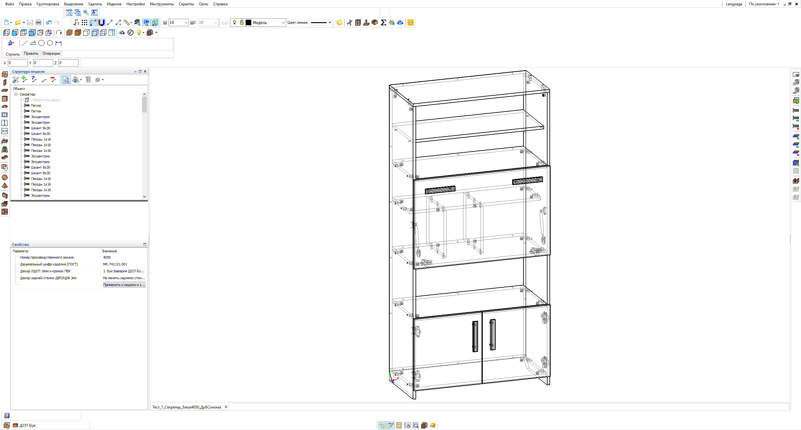
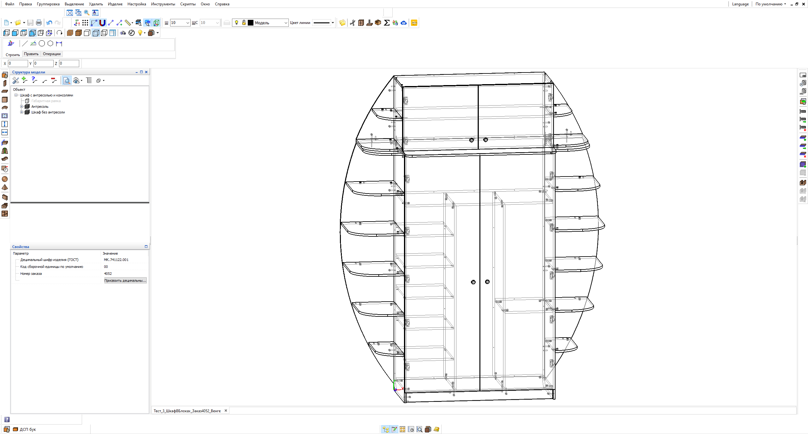
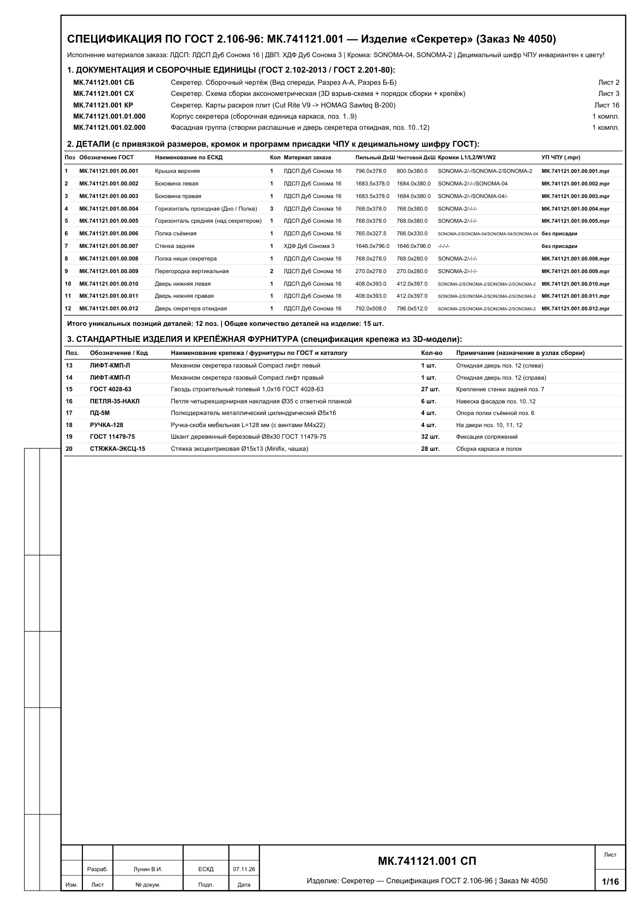
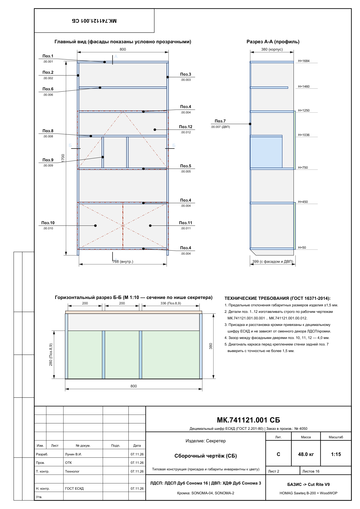
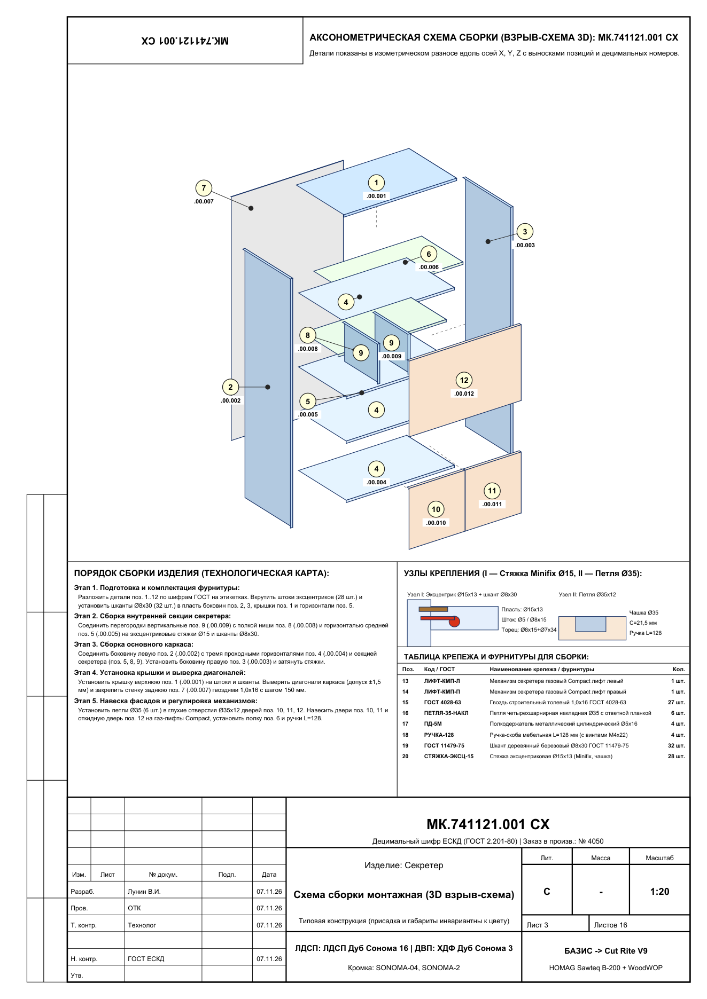
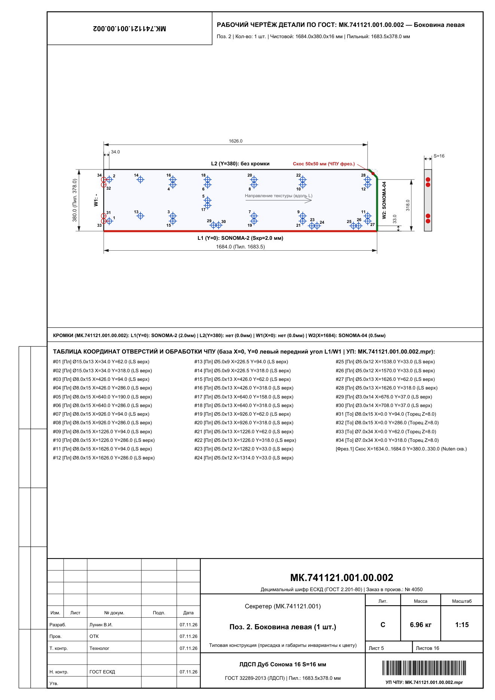
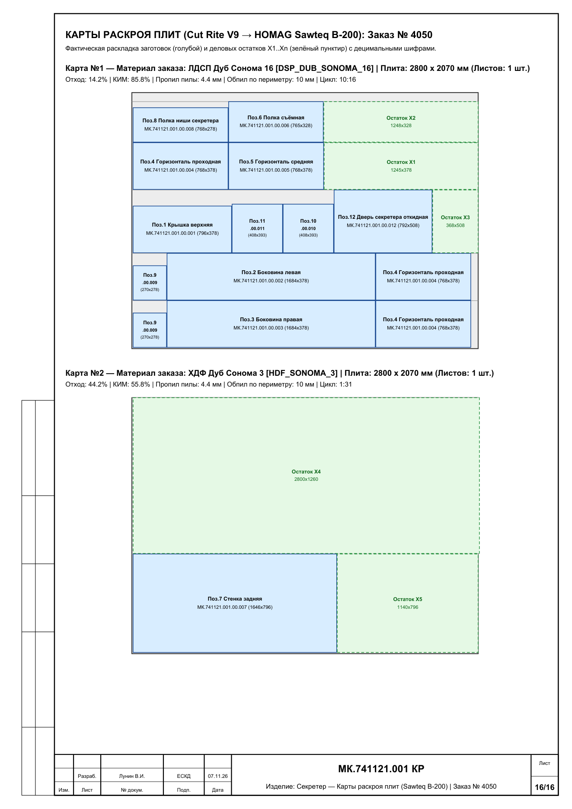
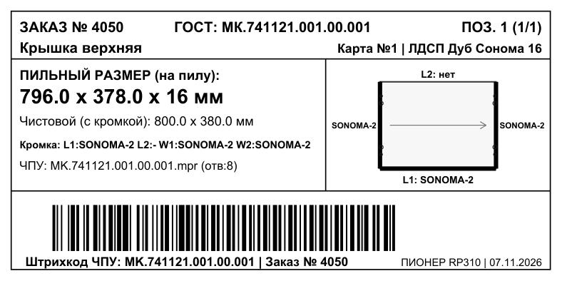

# БАЗИС 2021 — Инструментарий ЕСКД / ГОСТ, 1-клик смены цвета и заказа (F9 / F10), Раскрой Holzma SAWTEQ B-200 и ЧПУ

Комплект скриптов, шаблонов и производственных конфигураций для **БАЗИС 2021** (`БАЗИС-Мебельщик`, `БАЗИС-Шкаф`, `БАЗИС-Раскрой`, `БАЗИС-ЧПУ`, `БАЗИС-Бирка`, `БАЗИС-База материалов` Firebird):

1. **Заполнение децимальных номеров деталей по шаблону (`F10`)**:
   - Автоматически считывает шифр изделия (`%A`), уже заданный в модели (например, `889.00.000`, `889` или `МК.741121.001`), и формирует децимальные шифры всех деталей строго по вашему шаблону (`%A.%U.%P` -> `889.00.001`, `889.00.002`...).
   - Сохраняет пользовательские наименования деталей (`%N`) и предоставляет выпадающий список уставных ГОСТ-наименований в 1 клик (`Боковина левая`, `Боковина правая`, `Крышка верхняя`, `Дно нижнее`, `Полка`, `Перегородка вертикальная`, `Вязка горизонтальная`, `Стенка задняя`, `Планка цокольная`, `Царга`, `Столешница`, `Фасад` и др.).
   - Автоматически передаёт **Обозначение** и **Наименование** в:
     - **Штамп рабочего чертежа детали по ГОСТ 2.104** (Графа 2 = децимальный шифр `889.00.001`, Графа 1 = наименование `Боковина левая`);
     - **Спецификацию по ГОСТ 2.106**;
     - **Этикетку раскроя 100×50 мм** (`Pioneer_RP310_100x50.brx`) с инвариантным штрихкодом УП ЧПУ (`SK1` / `SK2`);
     - **Карты раскроя, накладные на производство и ведомости списания** (`БАЗИС-Раскрой`).
2. **Запуск типового изделия в производство в 1 клик (`F9`)**:
   - Меняет декор ЛДСП 16 мм, ХДФ 3 мм, парные кромки ПВХ `2,0×19 мм` / `0,4×19 мм` и номер производственного заказа без изменения габаритов, расположения кромки, карт присадки и децимальных шифров ЧПУ.

---

## Быстрая установка на любой ПК

1. Склонируйте репозиторий:
   ```powershell
   git clone https://github.com/lunin02118-ops/bazis-eskd-tools.git
   cd bazis-eskd-tools
   ```
2. Запустите автоматический установщик двойным кликом по **`install.bat`** (или из PowerShell: `.\install.ps1`).
   - Скрипт автоматически сделает резервную копию ваших текущих настроек в `%APPDATA%\Bazis\Backup_YYYYMMDD_HHMMSS`, адаптирует пути под ваш профиль Windows и установит скрипты `F9`/`F10`, настройки чертежей, раскроя, ЧПУ и шаблоны этикеток.

---

## Структура репозитория

| Папка / Файл | Назначение |
|---|---|
| [`scripts/utf8/`](scripts/utf8/) | Исходный код скриптов `F9` и `F10` в кодировке UTF-8 (для удобного просмотра на GitHub) |
| [`scripts/cp1251/`](scripts/cp1251/) | Рабочие скрипты `F9` и `F10` в кодировке `Windows-1251` для движка БАЗИС 2021 + `cipher_template.ini` |
| [`config/appdata/`](config/appdata/) | Конфигурации `%APPDATA%\Bazis\` (`CreateDrawings.xml`, `Settings.xml`, `CabSettings.xml`, `CNCSettings.xml`, `ActionData.xml`, `UserInterface.xml`, `CutSettings/`) |
| [`config/documents/`](config/documents/) | Шаблоны этикеток [`Pioneer_RP310_100x50.brx`](config/documents/%D0%A8%D0%B0%D0%B1%D0%BB%D0%BE%D0%BD%D1%8B%20%D0%B1%D0%B8%D1%80%D0%BA%D0%B8/Pioneer_RP310_100x50.brx), справочник [`Наименования_деталей_ГОСТ.ish`](config/documents/%D0%9D%D0%B0%D0%B8%D0%BC%D0%B5%D0%BD%D0%BE%D0%B2%D0%B0%D0%BD%D0%B8%D1%8F_%D0%B4%D0%B5%D1%82%D0%B0%D0%BB%D0%B5%D0%B9_%D0%93%D0%9E%D0%A1%D0%A2.ish), профили раскроя и ЧПУ |
| [`tools/`](tools/) | Python-утилиты настройки таблицы сопутствия материалов Firebird (`ATTEND_MAT_MAT`) и сквозного тестирования |
| [`docs/USER_MANUAL.md`](docs/USER_MANUAL.md) | Подробная пошаговая инструкция со скриншотами |
| [`docs/AUDIT_REPORT.md`](docs/AUDIT_REPORT.md) | Полный технический отчёт о настройке и тестировании |

---

## Скриншоты работы в БАЗИС 2021

### 1. Смена цвета ЛДСП, кромок и номера заказа в 1 клик (`F9`)


### 2. Заполнение децимальных шифров по шаблону (`F10`)


### 3. Автоматический выпуск конструкторской документации по ЕСКД / ГОСТ





### 4. Карты раскроя (Holzma SAWTEQ B-200 / Cut Rite V9) и Этикетка 100×50 мм (Pioneer RP310)

