# Инструкция конструктора: Работа в настроенной системе БАЗИС 2021 (ГОСТ ЕСКД + Типовые заказы + Holzma + ЧПУ + Бирка)

Данное руководство описывает пошаговый порядок работы конструктора непосредственно внутри штатных модулей **БАЗИС 2021** (`БАЗИС-Мебельщик`, `БАЗИС-Шкаф`, `БАЗИС-Раскрой`, `БАЗИС-Бирка`, `БАЗИС-ЧПУ`).

> [!IMPORTANT]
> **Главный принцип настроенной системы:**
> 1. **Децимальный шифр детали (`%A.%P`, например `МК.741121.001.00.002`)** жёстко связан с геометрией детали, схемой расположения кромки и программой присадки ЧПУ (`МК.741121.001.00.002.mpr`).
> 2. При запуске типового изделия в производство под новый заказ конструктор **не перестраивает присадку и не накатывает кромку заново** — он нажимает **`F9`**, вводит новый **Номер заказа** и выбирает из списка нужный **Декор ЛДСП и кромок ПВХ**.
> 3. На этикетку раскроя автоматически выводится **новый номер заказа и новый цвет ЛДСП/кромки**, а **штрихкод ЧПУ (`SK1`)** остаётся неизменным (`МК.741121.001.00.002`), благодаря чему станок с ЧПУ открывает готовую выверенную программу `.mpr`.

---

## Быстрая памятка по горячим клавишам в БАЗИС-Мебельщик 2021

| Клавиша | Меню в БАЗИС-Мебельщик | Назначение |
|---|---|---|
| **`F9`** | `Скрипты` $\rightarrow$ `1_Смена_цвета_ЛДСП_и_кромки_(Типовой_заказ)` | **Запуск типового заказа в производство:** смена номера заказа, цвета ЛДСП 16 мм, кромок ПВХ 2/19 и 0,4/19 и задней стенки ДВП/ХДФ 3 мм в 1 клик без изменения размеров и ЧПУ |
| **`F10`** | `Скрипты` $\rightarrow$ `2_Расстановка_децимальных_шифров_ГОСТ` | **Постановка нового изделия на учёт по ГОСТ:** автоматическая нормализация наименований деталей по ГОСТ 2.109 и присвоение децимальных позиций (`00.001`, `00.002`...) и шифров (`МК.XXXXXX.XXX.00.XXX`) |

---

## Сценарий 1. Запуск готового типового изделия в производство (смена цвета ЛДСП, кромки и номера заказа за 10 секунд)

Используется, когда в каталоге уже есть проверенная 3D-модель изделия с децимальными шифрами ГОСТ (например, [`Секретер.b3d`](file:///C:/Users/VladimirWorkPC/Documents/Bazis/%D0%9C%D0%BE%D0%B4%D0%B5%D0%BB%D0%B8/Samples/%D0%A1%D0%B5%D0%BA%D1%80%D0%B5%D1%82%D0%B5%D1%80.b3d), [`Шкаф в блоках.b3d`](file:///C:/Users/VladimirWorkPC/Documents/Bazis/%D0%9C%D0%BE%D0%B4%D0%B5%D0%BB%D0%B8/Samples/%D0%A8%D0%BA%D0%B0%D1%84%20%D0%B2%20%D0%B1%D0%BB%D0%BE%D0%BA%D0%B0%D1%85.b3d), [`Тумба_ГОСТ.b3d`](file:///C:/Users/VladimirWorkPC/Documents/Bazis/%D0%9C%D0%BE%D0%B4%D0%B5%D0%BB%D0%B8/Samples/%D0%A2%D1%83%D0%BC%D0%B1%D0%B0_%D0%93%D0%9E%D0%A1%D0%A2.b3d), [`Шкаф_кухонный_нижний_ГОСТ.b3d`](file:///C:/Users/VladimirWorkPC/Documents/Bazis/%D0%9C%D0%BE%D0%B4%D0%B5%D0%BB%D0%B8/Samples/%D0%A8%D0%BA%D0%B0%D1%84_%D0%BA%D1%83%D1%85%D0%BE%D0%BD%D0%BD%D1%8B%D0%B9_%D0%BD%D0%B8%D0%B6%D0%BD%D0%B8%D0%B9_%D0%93%D0%9E%D0%A1%D0%A2.b3d)), и поступил производственный заказ на это изделие в другом цвете.

### Пошаговый порядок действий:

1. **Откройте модель типового изделия** в **БАЗИС-Мебельщик 2021** (`Файл` $\rightarrow$ `Открыть`).
   - В левой нижней панели **«Свойства»** отображаются текущие реквизиты модели (`Наименование: Секретер`, `Артикул: МК.741121.001`).
2. **Нажмите клавишу `F9`** (или выберите в верхнем меню `Скрипты` $\rightarrow$ `1_Смена_цвета_ЛДСП_и_кромки_(Типовой_заказ)`).
3. В левой нижней панели **«Свойства»** появится форма управления типовым заказом:
   - **Номер производственного заказа:** введите номер нового заказа (например, `4050`).
   - **Децимальный шифр изделия (ГОСТ):** оставьте штатный шифр изделия (например, `МК.741121.001`).
   - **Декор ЛДСП 16мм и кромок ПВХ:** выберите нужный декор из выпадающего списка:
     1. *Бук Бавария* (`ДСП бук 16` + кромки `Бук2/19` и `Бук0,4/19`)
     2. *Белый базовый* (`ДСП белая 16` + кромки `Бел2/19` и `Бел0,4/19`)
     3. *Дуб Сонома* (`ЛДСП 16мм Дуб Сонома` + кромки `Сон2/19` и `Сон0,4/19`)
     4. *Венге Цаво* (`ЛДСП 16мм Венге Цаво` + кромки `Вен2/19` и `Вен0,4/19`)
     5. *Кашемир серый* (`ЛДСП 16мм Кашемир серый` + кромки `Каш2/19` и `Каш0,4/19`)
     6. *Антрацит* (`ЛДСП 16мм Антрацит` + кромки `Ант2/19` и `Ант0,4/19`)
     7. *Дуб Галифакс* (`ЛДСП 16мм Дуб Галифакс` + кромки `Гал2/19` и `Гал0,4/19`)
   - **Декор задней стенки ДВП/ХДФ 3мм:** при необходимости выберите `ДВП ламинированная белая (3мм)` или `ДВП ламинированная клен (3мм)`.
4. **Нажмите кнопку `Применить к модели и закрыть`** в окне свойств.
   - Скрипт автоматически перестроит все детали (включая детали внутри вложенных блоков любой глубины), заменит толстую кромку `2,0 мм` на сопутствующую `2/19`, тонкую кромку `0,4 мм` — на сопутствующую `0,4/19`, обновит номер заказа и сохранит неизменными все размеры, пазы, присадку и децимальные шифры.

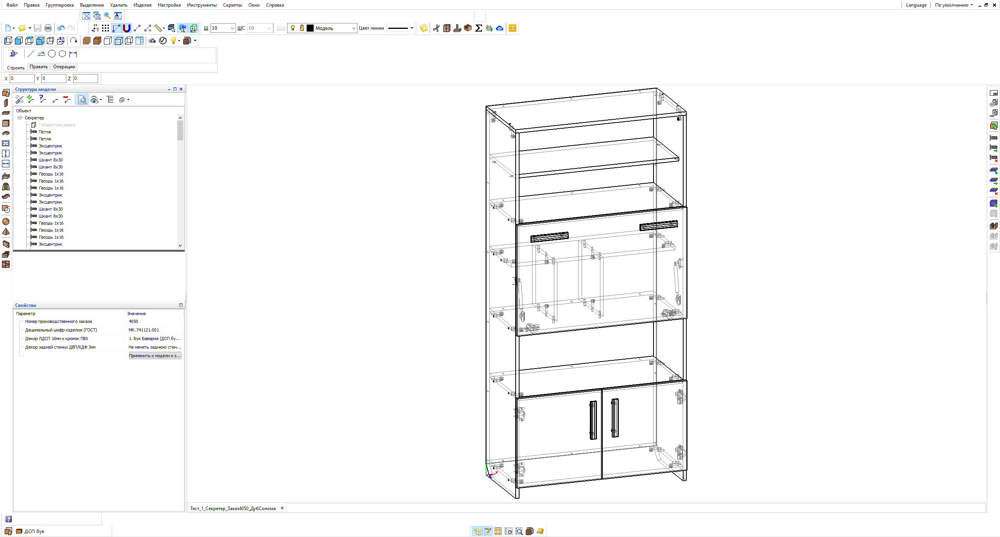

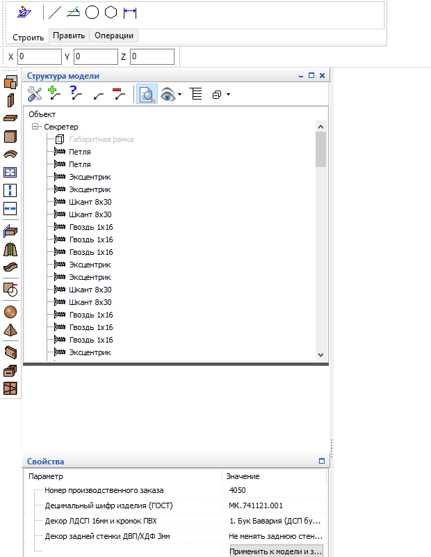

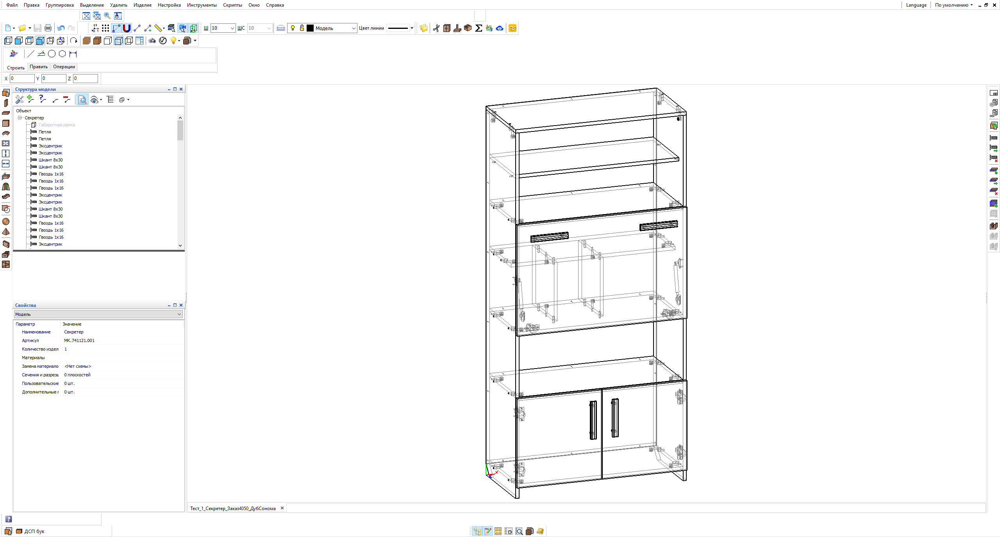

---

## Сценарий 2. Создание нового изделия и автоматическая расстановка децимальных шифров ГОСТ (`F10`)

Используется, когда конструктор спроектировал новое изделие в **БАЗИС-Мебельщик** или **БАЗИС-Шкаф** (где детали изначально называются `Горизонтальная1`, `Вертикальная2`, `Фронтальная1` и не имеют децимальных шифров ГОСТ).

### Пошаговый порядок действий (заполнение децимальных номеров по шаблону):

1. **Задайте шифр изделия и назовите детали:**
   - В `Изделие` $\rightarrow$ `Параметры изделия` (поле **«Артикул»**) укажите ваш шифр изделия — например, `889.00.000` (или `889`, или `МК.741121.001`).
   - При создании или редактировании панелей выбирайте готовое наименование детали по ГОСТ в 1 клик из выпадающего списка ([`ActionData.xml`](file:///C:/Users/VladimirWorkPC/AppData/Roaming/Bazis/ActionData.xml) и [`Наименования_деталей_ГОСТ.ish`](file:///C:/Users/VladimirWorkPC/Documents/Bazis/%D0%9D%D0%B0%D0%B8%D0%BC%D0%B5%D0%BD%D0%BE%D0%B2%D0%B0%D0%BD%D0%B8%D1%8F_%D0%B4%D0%B5%D1%82%D0%B0%D0%BB%D0%B5%D0%B9_%D0%93%D0%9E%D0%A1%D0%A2.ish): `Боковина левая`, `Боковина правая`, `Крышка верхняя`, `Дно нижнее`, `Полка`, `Полка съёмная`, `Перегородка вертикальная`, `Вязка горизонтальная`, `Стенка задняя`, `Планка цокольная`, `Царга`, `Столешница`, `Фасад`, `Дверь левая`, `Дверь правая`, детали ящиков) или впишите своё название вручную. В [`Settings.xml`](file:///C:/Users/VladimirWorkPC/AppData/Roaming/Bazis/Settings.xml) отключена автоподстановка технических цифр `1, 2, 3` к именам панелей (`<NumberingObjects>N</NumberingObjects>`).
   - Благодаря включённой настройке **SLKM** в [`CabSettings.xml`](file:///C:/Users/VladimirWorkPC/AppData/Roaming/Bazis/CabSettings.xml) и заполненной таблице сопутствия `ATTEND_MAT_MAT` в базе Firebird [`Учебная база материалов.FDB`](file:///C:/Users/VladimirWorkPC/Documents/Bazis/%D0%A3%D1%87%D0%B5%D0%B1%D0%BD%D0%B0%D1%8F%20%D0%B1%D0%B0%D0%B7%D0%B0%20%D0%BC%D0%B0%D1%82%D0%B5%D1%80%D0%B8%D0%B0%D0%BB%D0%BE%D0%B2/%D0%A3%D1%87%D0%B5%D0%B1%D0%BD%D0%B0%D1%8F%20%D0%B1%D0%B0%D0%B7%D0%B0%20%D0%BC%D0%B0%D1%82%D0%B5%D1%80%D0%B8%D0%B0%D0%BB%D0%BE%D0%B2.FDB), при выборе плиты ЛДСП программа автоматически предлагает только парные кромки того же цвета (`2/19` и `0,4/19`).
2. **Нажмите клавишу `F10`** (скрипт [`2_Расстановка_децимальных_шифров_ГОСТ.js`](file:///C:/Users/VladimirWorkPC/Documents/Bazis/Scripts/2_%D0%A0%D0%B0%D1%81%D1%81%D1%82%D0%B0%D0%BD%D0%BE%D0%B2%D0%BA%D0%B0_%D0%B4%D0%B5%D1%86%D0%B8%D0%BC%D0%B0%D0%BB%D1%8C%D0%BD%D1%8B%D1%85_%D1%88%D0%B8%D1%84%D1%80%D0%BE%D0%B2_%D0%93%D0%9E%D0%A1%D0%A2.js)).
3. В левой нижней панели **«Свойства»** автоматически подтянутся настройки из вашей модели и файла шаблона [`cipher_template.ini`](file:///C:/Users/VladimirWorkPC/Documents/Bazis/Scripts/cipher_template.ini):
   - **Шифр изделия (`%A`):** считывается автоматически из `Параметров изделия` (например, `889.00.000` или `МК.741121.001`). Если шифр изделия записан с суффиксом `.00.000`, скрипт автоматически выделяет базовый шифр `889`, чтобы не задваивать нули (`889.00.001`, а не `889.00.000.00.001`).
   - **Шаблон децимального шифра детали:** по умолчанию `%A.%U.%P` (сохраняется в [`cipher_template.ini`](file:///C:/Users/VladimirWorkPC/Documents/Bazis/Scripts/cipher_template.ini) — достаточно задать один раз):
     - `%A` — базовый шифр изделия (`889` или `МК.741121.001`);
     - `%U` — код сборочной единицы (`00` для деталей корпуса или `01`, `02`... для входящих подсборок/блоков);
     - `%P` — порядковый номер детали с ведущими нулями (`001`, `002`... или `01`, `02`...).
   - **Наименования деталей (`%N`):**
     - `Сохранять мои названия (заменять только Горизонтальная/Вертикальная)` *(по умолчанию)* — полностью сохраняет все названия, которые вы дали деталям, исправляя только оставшиеся технические имена БАЗИС (`Горизонтальная1`, `Вертикальная2`);
     - `Не менять наименования деталей (только заполнить шифры по шаблону)`;
     - `Переименовать все детали по шаблону ГОСТ`.
4. **Нажмите кнопку `Заполнить децимальные шифры по шаблону`**.
   - Каждая деталь получит строгое децимальное обозначение по вашему шаблону (например, `889.00.001`, `889.00.002`...) и передаст его сквозным потоком в:
     - **Штамп чертежа детали** (`Графа 2` = `889.00.001`, `Графа 1` = `Боковина левая`),
     - **Спецификацию ГОСТ**,
     - **Этикетку раскроя** ([`Pioneer_RP310_100x50.brx`](file:///C:/Users/VladimirWorkPC/Documents/Bazis/%D0%A8%D0%B0%D0%B1%D0%BB%D0%BE%D0%BD%D1%8B%20%D0%B1%D0%B8%D1%80%D0%BA%D0%B8/Pioneer_RP310_100x50.brx)),
     - **Карты раскроя, накладные на производство и ведомости списания** ([`CutSettings.xml`](file:///C:/Users/VladimirWorkPC/AppData/Roaming/Bazis/CutSettings/CutSettings.xml)).

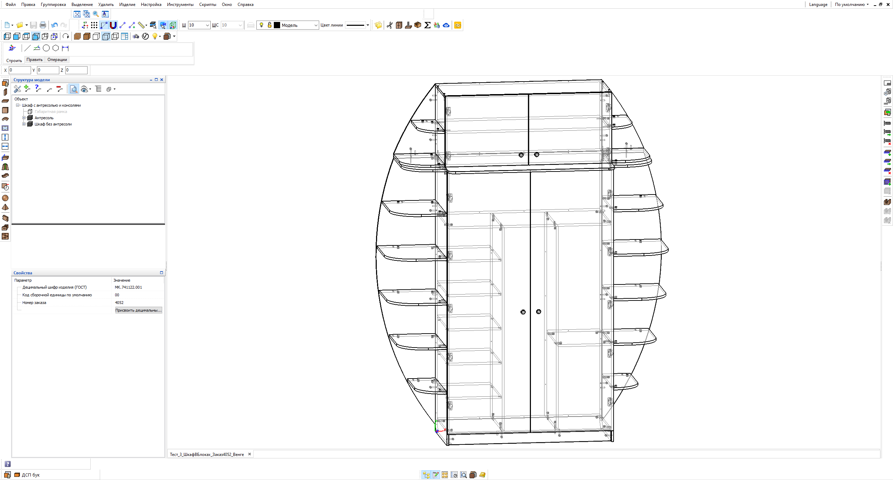

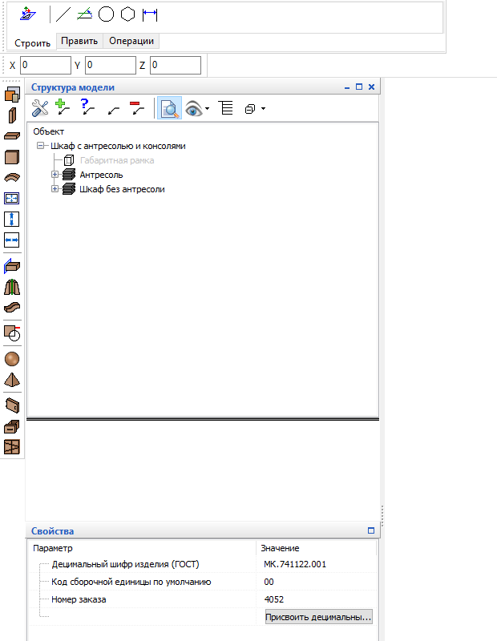

---

## Сценарий 3. Автоматический выпуск конструкторской документации (Чертежи деталей, Схемы сборки, Спецификация ЕСКД)

Все шаблоны штампов и масок именования по ГОСТ 2.104 / ГОСТ 2.106 / ГОСТ 2.109 уже прописаны в [`CreateDrawings.xml`](file:///C:/Users/VladimirWorkPC/AppData/Roaming/Bazis/CreateDrawings.xml) и [`Settings.xml`](file:///C:/Users/VladimirWorkPC/AppData/Roaming/Bazis/Settings.xml):
- **Обозначение в спецификации и штампе чертежа детали:** `%A.%P` (`МК.741121.001.00.002`)
- **Наименование чертежа детали:** `%A.%P %N` (`МК.741121.001.00.002 Боковина левая`)
- **Обозначение сборочного чертежа:** `%A СБ %I` (`МК.741121.001 СБ Секретер`)
- **Обозначение спецификации:** `%A СП %I` (`МК.741121.001 СП Секретер`)

### Как сформировать комплект чертежей в БАЗИС-Мебельщик:
1. На верхней панели инструментов нажмите иконку **«Создание чертежей»** (или меню `Выпуск чертежей` $\rightarrow$ `Создать чертежи`).
2. Отметьте галочками:
   - `Чертежи панелей` (с таблицей координат отверстий, указанием облицовки кромок и направлением текстуры)
   - `Сборочный чертёж` и `Схема сборки`
   - `Спецификация`
3. Нажмите **«ОК»** — система сформирует листы `.ldw` / PDF с заполненными штампами ГОСТ.

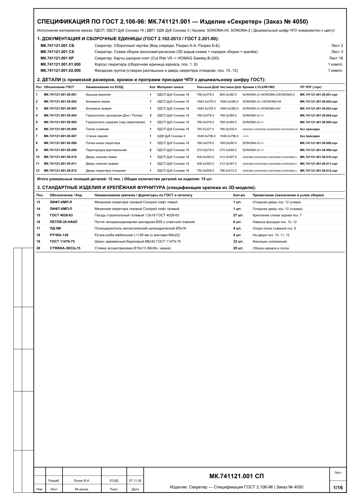

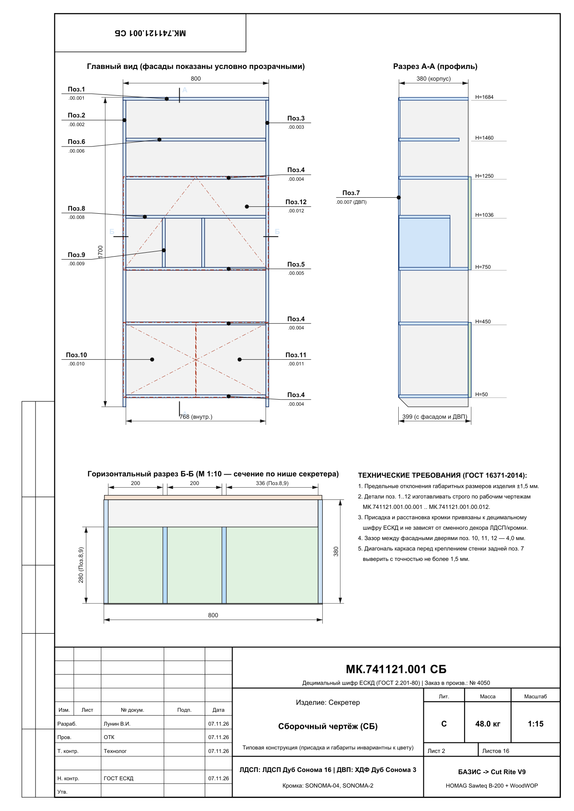

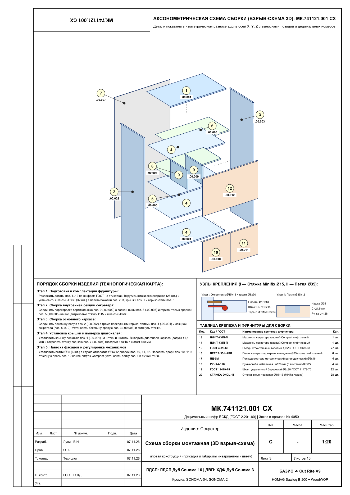

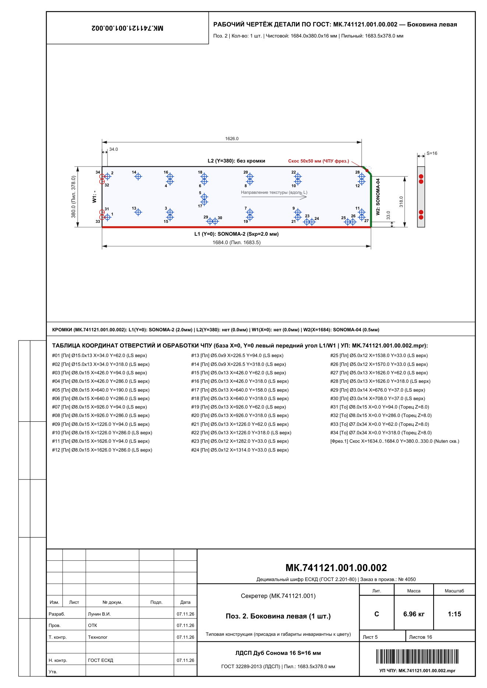

---

## Сценарий 4. Раскрой плит в БАЗИС-Раскрой 2021 и выгрузка на пильный центр Holzma SAWTEQ B-200 / Cut Rite V9

Настройки раскроя в [`CutSettings.xml`](file:///C:/Users/VladimirWorkPC/AppData/Roaming/Bazis/CutSettings/CutSettings.xml) и [`Holzma_CadLink3_SAWTEQ_B200.cutconfig`](file:///C:/Users/VladimirWorkPC/Documents/Bazis/%D0%A4%D0%B0%D0%B9%D0%BB%D1%8B%20%D0%B4%D0%BB%D1%8F%20%D0%BF%D0%B8%D0%BB%D1%8C%D0%BD%D1%8B%D1%85%20%D1%86%D0%B5%D0%BD%D1%82%D1%80%D0%BE%D0%B2/Holzma_CadLink3_SAWTEQ_B200.cutconfig), а также форматы листов `2800 × 2070 мм` для всех декоров в [`CutMaterialSettings.xml`](file:///C:/Users/VladimirWorkPC/AppData/Roaming/Bazis/CutSettings/CutMaterialSettings.xml) уже сконфигурированы:
- **Формат плиты ЛДСП / ХДФ:** `2800 × 2070 мм`
- **Торцевой опил плиты со всех 4 сторон (`Undercut` / `RoughAllowance`):** `10 / 10 / 10 / 10 мм` (чистая зона `2780 × 2050 мм`)
- **Ширина пропила главной пилы:** `4,4 мм`
- **Максимальная высота пакета (SAWTEQ B-200, вылет пилы 65 мм):** `4 плиты` по 16 мм (`64 мм`)
- **Выгрузка управляющих программ раскроя:** постпроцессор `Holzma_Cadlink3` автоматически создаёт подпапку с номером заказа (`C:\SawTransfer\B200\<Номер_заказа>\`) и сохраняет туда файл `.ptx` для пильного центра.

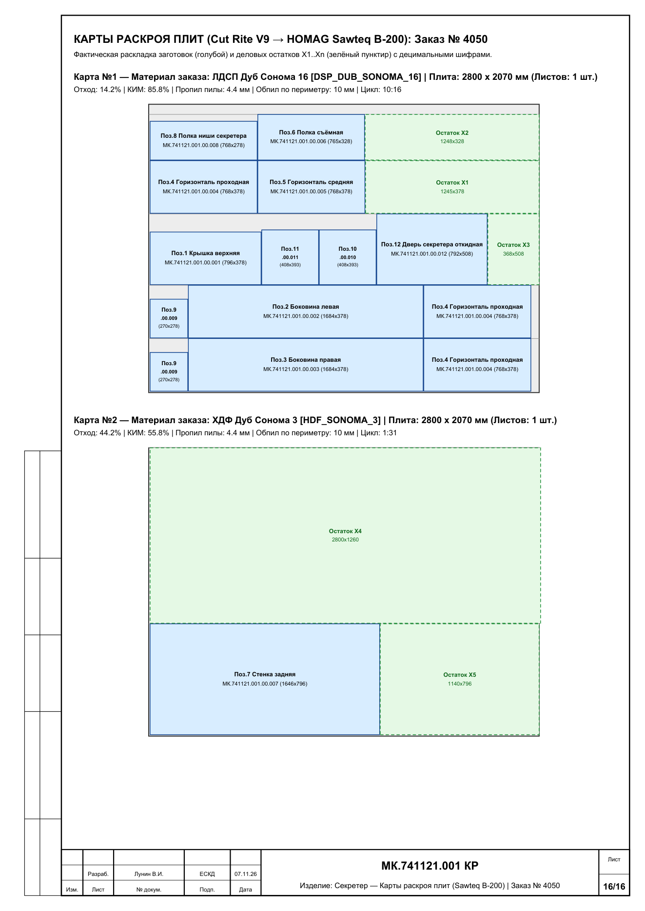

---

## Сценарий 5. Печать этикеток в БАЗИС-Бирка и работа со станком ЧПУ (Homag WoodWOP `.mpr`)

Шаблоны этикеток `100 × 50 мм` для термопринтера **Pioneer RP310** синхронизированы в файлах [`Pioneer_RP310_100x50.brx`](file:///C:/Users/VladimirWorkPC/Documents/Bazis/%D0%A8%D0%B0%D0%B1%D0%BB%D0%BE%D0%BD%D1%8B%20%D0%B1%D0%B8%D1%80%D0%BA%D0%B8/Pioneer_RP310_100x50.brx) и [`BirkiShab 100x50.brx`](file:///C:/Users/VladimirWorkPC/Documents/Bazis/%D0%A8%D0%B0%D0%B1%D0%BB%D0%BE%D0%BD%D1%8B%20%D0%B1%D0%B8%D1%80%D0%BA%D0%B8/BirkiShab%20100x50.brx), а настройки постпроцессора **БАЗИС-ЧПУ** записаны в [`CNCSettings.xml`](file:///C:/Users/VladimirWorkPC/AppData/Roaming/Bazis/CNCSettings.xml) и [`Homag_WoodWop_MPR.pstconfig`](file:///C:/Users/VladimirWorkPC/Documents/Bazis/%D0%A4%D0%B0%D0%B9%D0%BB%D1%8B%20%D0%B4%D0%BB%D1%8F%20%D0%A7%D0%9F%D0%A3/Homag_WoodWop_MPR.pstconfig).

### Что выводится на этикетку раскроя (`100 × 50 мм`):
1. **Заказ:** динамический номер производственного заказа (например, `Заказ №4050` — меняется при нажатии `F9`).
2. **Изделие и Деталь (ГОСТ):** `Секретер (МК.741121.001)` и уставное имя `Боковина левая` с позицией `Поз. 00.002`.
3. **Материал:** актуальный выбранный цвет плиты (например, `ЛДСП 16мм Дуб Сонома`).
4. **Размеры детали (Готовая / Пильная заготовка):** `1684 × 380 × 16 мм` (готовая) и `1683,2 × 378,0 × 16 мм` (с вычетом толщины кромки ПВХ на прифуговку/подрезку).
5. **Рамка кромления по 4 сторонам:** показывает, на каких именно торцах (`L1, L2, W1, W2`) накатана кромка и её новую маркировку (`Сон2/19`, `Сон0,4/19`).
6. **Штрихкод Code-128 для ЧПУ (`SK1`):** формируется по формуле `[Обозначение изделия].[Номер позиции]` $\rightarrow$ **`МК.741121.001.00.002`** (**без номера заказа!**).
   - Когда оператор ЧПУ сканирует этот штрихкод, станок открывает файл [`МК.741121.001.00.002.mpr`](file:///C:/Users/VladimirWorkPC/Documents/Bazis/%D0%A4%D0%B0%D0%B9%D0%BB%D1%8B%20%D0%B4%D0%BB%D1%8F%20%D0%A7%D0%9F%D0%A3/MPR/%D0%9C%D0%9A.741121.001.00.002.mpr) из папки `C:\Users\VladimirWorkPC\Documents\Bazis\Файлы для ЧПУ\MPR\`, который не зависит от цвета ЛДСП и номера заказа.

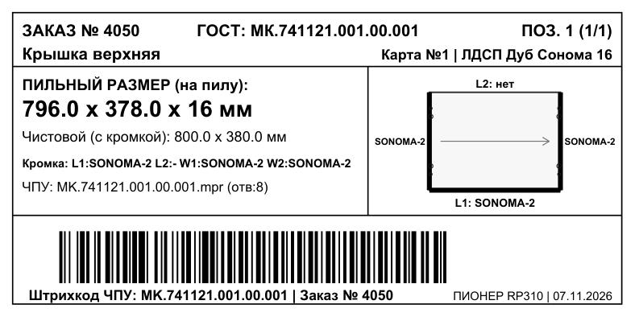

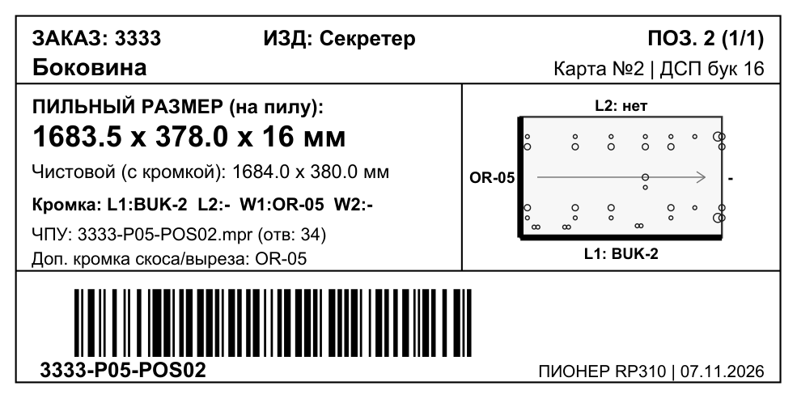

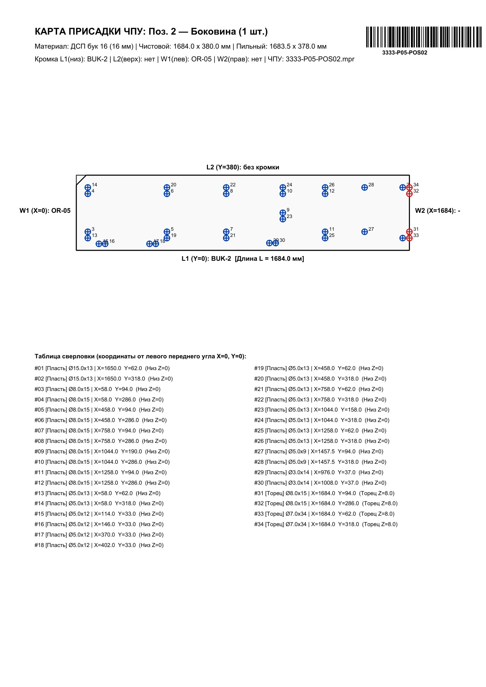

---

## Где лежат все настроенные файлы и протестированные образцы моделей

- **Скрипты конструктора (`F9` и `F10`):**
  - [`1_Смена_цвета_ЛДСП_и_кромки_(Типовой_заказ).js`](file:///C:/Users/VladimirWorkPC/Documents/Bazis/Scripts/1_%D0%A1%D0%BC%D0%B5%D0%BD%D0%B0_%D1%86%D0%B2%D0%B5%D1%82%D0%B0_%D0%9B%D0%94%D0%A1%D0%9F_%D0%B8_%D0%BA%D1%80%D0%BE%D0%BC%D0%BA%D0%B8_(%D0%A2%D0%B8%D0%BF%D0%BE%D0%B2%D0%BE%D0%B9_%D0%B7%D0%B0%D0%BA%D0%B0%D0%B7).js)
  - [`2_Расстановка_децимальных_шифров_ГОСТ.js`](file:///C:/Users/VladimirWorkPC/Documents/Bazis/Scripts/2_%D0%A0%D0%B0%D1%81%D1%81%D1%82%D0%B0%D0%BD%D0%BE%D0%B2%D0%BA%D0%B0_%D0%B4%D0%B5%D1%86%D0%B8%D0%BC%D0%B0%D0%BB%D1%8C%D0%BD%D1%8B%D1%85_%D1%88%D0%B8%D1%84%D1%80%D0%BE%D0%B2_%D0%93%D0%9E%D0%A1%D0%A2.js)
- **Протестированные модели изделий (в папке [`C:\Users\VladimirWorkPC\Documents\Bazis\Модели\Samples\`](file:///C:/Users/VladimirWorkPC/Documents/Bazis/%D0%9C%D0%BE%D0%B4%D0%B5%D0%BB%D0%B8/Samples/)):**
  1. **Секретер (`МК.741121.001`):** эталон [`Секретер.b3d`](file:///C:/Users/VladimirWorkPC/Documents/Bazis/%D0%9C%D0%BE%D0%B4%D0%B5%D0%BB%D0%B8/Samples/%D0%A1%D0%B5%D0%BA%D1%80%D0%B5%D1%82%D0%B5%D1%80.b3d) и заказ №4050 (*Дуб Сонома*) [`Тест_1_Секретер_Заказ4050_ДубСонома.b3d`](file:///C:/Users/VladimirWorkPC/Documents/Bazis/%D0%9C%D0%BE%D0%B4%D0%B5%D0%BB%D0%B8/Samples/%D0%A2%D0%B5%D1%81%D1%82_1_%D0%A1%D0%B5%D0%BA%D1%80%D0%B5%D1%82%D0%B5%D1%80_%D0%97%D0%B0%D0%BA%D0%B0%D0%B74050_%D0%94%D1%83%D0%B1%D0%A1%D0%BE%D0%BD%D0%BE%D0%BC%D0%B0.b3d)
  2. **Секретер в блоках (`МК.741121.002`):** эталон [`Секретер в блоках.b3d`](file:///C:/Users/VladimirWorkPC/Documents/Bazis/%D0%9C%D0%BE%D0%B4%D0%B5%D0%BB%D0%B8/Samples/%D0%A1%D0%B5%D0%BA%D1%80%D0%B5%D1%82%D0%B5%D1%80%20%D0%B2%20%D0%B1%D0%BB%D0%BE%D0%BA%D0%B0%D1%85.b3d) и заказ №4051 (*Кашемир серый*) [`Тест_2_СекретерВБлоках_Заказ4051_Кашемир.b3d`](file:///C:/Users/VladimirWorkPC/Documents/Bazis/%D0%9C%D0%BE%D0%B4%D0%B5%D0%BB%D0%B8/Samples/%D0%A2%D0%B5%D1%81%D1%82_2_%D0%A1%D0%B5%D0%BA%D1%80%D0%B5%D1%82%D0%B5%D1%80%D0%92%D0%91%D0%BB%D0%BE%D0%BA%D0%B0%D1%85_%D0%97%D0%B0%D0%BA%D0%B0%D0%B74051_%D0%9A%D0%B0%D1%88%D0%B5%D0%BC%D0%B8%D1%80.b3d)
  3. **Шкаф с антресолью и консолями (`МК.741122.001`, 45 деталей):** эталон [`Шкаф в блоках.b3d`](file:///C:/Users/VladimirWorkPC/Documents/Bazis/%D0%9C%D0%BE%D0%B4%D0%B5%D0%BB%D0%B8/Samples/%D0%A8%D0%BA%D0%B0%D1%84%20%D0%B2%20%D0%B1%D0%BB%D0%BE%D0%BA%D0%B0%D1%85.b3d) и заказ №4052 (*Венге Цаво*) [`Тест_3_ШкафВБлоках_Заказ4052_Венге.b3d`](file:///C:/Users/VladimirWorkPC/Documents/Bazis/%D0%9C%D0%BE%D0%B4%D0%B5%D0%BB%D0%B8/Samples/%D0%A2%D0%B5%D1%81%D1%82_3_%D0%A8%D0%BA%D0%B0%D1%84%D0%92%D0%91%D0%BB%D0%BE%D0%BA%D0%B0%D1%85_%D0%97%D0%B0%D0%BA%D0%B0%D0%B74052_%D0%92%D0%B5%D0%BD%D0%B3%D0%B5.b3d)
  4. **Тумба с дверью и полкой (`МК.741123.001`, с пазами и стяжками):** эталон [`Тумба_ГОСТ.b3d`](file:///C:/Users/VladimirWorkPC/Documents/Bazis/%D0%9C%D0%BE%D0%B4%D0%B5%D0%BB%D0%B8/Samples/%D0%A2%D1%83%D0%BC%D0%B1%D0%B0_%D0%93%D0%9E%D0%A1%D0%A2.b3d) и заказ №4053 (*Антрацит*) [`Тест_4_Тумба_Заказ4053_Антрацит.b3d`](file:///C:/Users/VladimirWorkPC/Documents/Bazis/%D0%9C%D0%BE%D0%B4%D0%B5%D0%BB%D0%B8/Samples/%D0%A2%D0%B5%D1%81%D1%82_4_%D0%A2%D1%83%D0%BC%D0%B1%D0%B0_%D0%97%D0%B0%D0%BA%D0%B0%D0%B74053_%D0%90%D0%BD%D1%82%D1%80%D0%B0%D1%86%D0%B8%D1%82.b3d)
  5. **Шкаф кухонный нижний (`МК.741124.001`, с опорами и евровинтами):** эталон [`Шкаф_кухонный_нижний_ГОСТ.b3d`](file:///C:/Users/VladimirWorkPC/Documents/Bazis/%D0%9C%D0%BE%D0%B4%D0%B5%D0%BB%D0%B8/Samples/%D0%A8%D0%BA%D0%B0%D1%84_%D0%BA%D1%83%D1%85%D0%BE%D0%BD%D0%BD%D1%8B%D0%B9_%D0%BD%D0%B8%D0%B6%D0%BD%D0%B8%D0%B9_%D0%93%D0%9E%D0%A1%D0%A2.b3d) и заказ №4054 (*Дуб Галифакс*) [`Тест_5_ШкафКухонный_Заказ4054_Галифакс.b3d`](file:///C:/Users/VladimirWorkPC/Documents/Bazis/%D0%9C%D0%BE%D0%B4%D0%B5%D0%BB%D0%B8/Samples/%D0%A2%D0%B5%D1%81%D1%82_5_%D0%A8%D0%BA%D0%B0%D1%84%D0%9A%D1%83%D1%85%D0%BE%D0%BD%D0%BD%D1%8B%D0%B9_%D0%97%D0%B0%D0%BA%D0%B0%D0%B74054_%D0%93%D0%B0%D0%BB%D0%B8%D1%84%D0%B0%D0%BA%D1%81.b3d)
